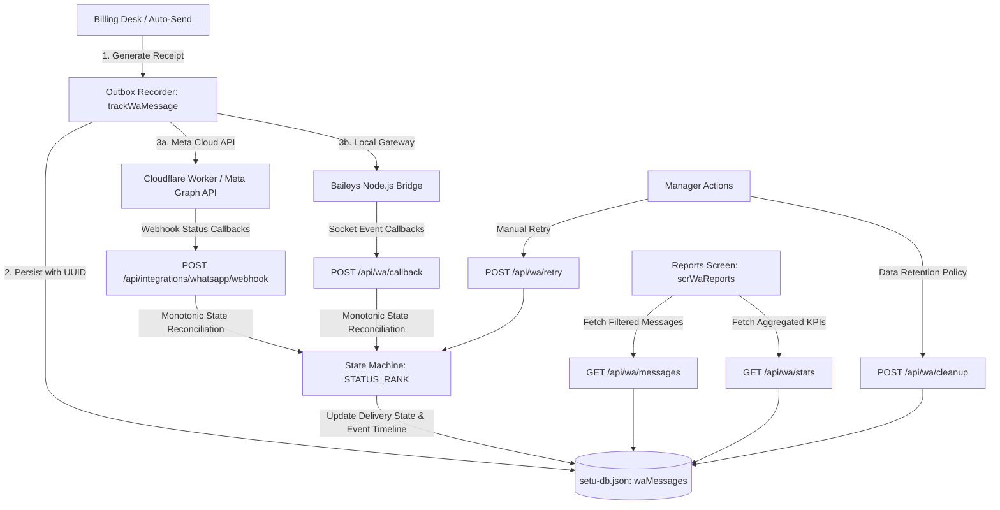

# WhatsApp Reports & Message Tracking Module — Implementation Specification
**Document ID:** SETU-QA-WA-001  
**Project:** Setu Pro Hotel ERP  
**Module:** WhatsApp Reports & Real-Time Message Tracking  
**Version:** 2.4.0-Production  
**Status:** Verified & Complete  
**Date:** 2026-10-29  

---

## 1. Executive Summary & Objective

The **WhatsApp Reports & Message Tracking Module** in Setu Pro Hotel ERP provides hotel management, auditors, and billing staff with a production-grade, permanent, and auditable accounting of all automated and manual WhatsApp dispatches. 

Unlike basic messaging integrations that assume message delivery upon HTTP 200 acceptance, this system implements a strict, asynchronous, monotonic state machine that tracks messages from initial outbox queuing through provider dispatch, gateway acceptance, on-device delivery, and customer read confirmation ("blue ticks").

The system seamlessly integrates with both:
1. **Meta WhatsApp Business Cloud API** (via Cloudflare Durable Objects and direct Graph API webhook ingestion)
2. **Baileys Gateway** (for localized linked phone QR pairing via TCP web-socket bridge)

---

## 2. Architecture & Data Flow



---

## 3. Database Schema: `waMessages` Store

All messages are stored under `D.waMessages` in `setu-db.json` (and replicated through Cloudflare Durable Object storage in cloud sync mode).

### Message Object Schema
| Field Name | Type | Description |
| :--- | :--- | :--- |
| `id` | `String` (UUID) | Unique internal message identifier (e.g., `wa_1793263749687_a9cd8fca`). |
| `hotelId` | `String` | Tenant identifier ensuring strict multi-tenant boundary isolation. |
| `billId` | `String` | Foreign key referencing `D.bills[i].id`. |
| `billNo` | `Number` | Human-readable sequential invoice number. |
| `customerName` | `String` | Customer name extracted from bill or CRM. |
| `phone` | `String` | Full raw E.164 phone number (never exposed to cashiers). |
| `maskedPhone` | `String` | Formatted masked representation (e.g., `98****3210`). |
| `msgType` | `String` | Categorization: `receipt`, `summary`, `notification`, or `test`. |
| `provider` | `String` | Underlying engine: `meta` or `baileys`. |
| `providerMsgId` | `String` | Provider tracking ID (`wamid.HBgM...` or Baileys stanza ID). |
| `templateName` | `String` | Approved Meta template name (e.g., `setu_receipt_v1`). |
| `status` | `String` | Current canonical state from the 10-state lifecycle enum. |
| `consentRef` | `String` | Customer consent verification audit tag (`explicit_opt_in`). |
| `requestedAt` | `Number` | Unix millisecond timestamp when request entered outbox. |
| `submittedAt` | `Number\|null` | Unix millisecond timestamp when accepted by Meta/Baileys. |
| `sentAt` | `Number\|null` | Unix millisecond timestamp when transmitted upstream. |
| `deliveredAt` | `Number\|null` | Unix millisecond timestamp when confirmed on customer handset. |
| `readAt` | `Number\|null` | Unix millisecond timestamp when read confirmation received. |
| `failedAt` | `Number\|null` | Unix millisecond timestamp when rejection/failure was recorded. |
| `errorCode` | `String` | Provider error code (e.g., `131026`, `429_RATE_LIMIT`). |
| `errorReason` | `String` | Descriptive diagnostics for failures and bounces. |
| `idemKey` | `String` | Idempotency hash `wa_bill_{hotelId}_{billId}` preventing duplicate dispatches. |
| `attemptCount` | `Number` | Total number of transmission attempts executed (starts at 1). |
| `retryEligible` | `Boolean` | Flag indicating whether message is eligible for manual retry. |
| `staff` | `String` | Staff member identity who finalized the bill or triggered dispatch. |
| `events` | `Array<Event>` | Complete chronological log of status transitions. |
| `attempts` | `Array<Attempt>` | Independent log of each dispatch attempt. |

---

## 4. State Machine Architecture & Transition Hierarchy

The lifecycle enforces monotonic state progression:

```
QUEUED (Rank 1)
  ↓
PROCESSING (Rank 2)
  ↓
SUBMITTED (Rank 3)
  ↓
SENT (Rank 4)
  ↓
DELIVERED (Rank 5)
  ↓
READ (Rank 6)
```

Terminal & Exception States:
- `FAILED` (Rank -1)
- `UNKNOWN` (Rank -2)
- `SKIPPED` (Rank -3)
- `CANCELLED` (Rank -4)

### State Machine Rules:
1. **Monotonic Hierarchy:** Once a message reaches `DELIVERED` (Rank 5) or `READ` (Rank 6), delayed callbacks reporting `SENT` (Rank 4) or `SUBMITTED` (Rank 3) are recorded in the `events` timeline but **CANNOT demote or regress** the message status.
2. **Terminal Preservation:** Messages in `DELIVERED` or `READ` cannot be marked `FAILED` by delayed callbacks.
3. **Idempotent Callbacks:** Multiple callbacks with identical statuses within short windows do not duplicate records in the `events` timeline.
4. **Normalized Status Mapping:** Unrecognized status strings from upstream gateways safely map to `UNKNOWN` rather than crashing the database.

---

## 5. API Endpoints Reference

### 5.1 Backend Endpoints (`app_main.py` & `cloud/src/worker.js`)

| Method | Endpoint | Access Role | Description |
| :--- | :--- | :--- | :--- |
| `GET` | `/api/integrations/whatsapp/webhook` | Public / Meta | Webhook verification challenge (`hub.mode`, `hub.verify_token`, `hub.challenge`). |
| `POST` | `/api/integrations/whatsapp/webhook` | Meta Webhook | Ingests real-time message status updates (`sent`, `delivered`, `read`, `failed`). |
| `GET` | `/api/wa/messages` | Cashier, Manager, Owner | Paginated query of WhatsApp messages with role-based phone masking and tenant isolation. |
| `GET` | `/api/wa/stats` | Cashier, Manager, Owner | Aggregates delivery KPIs, failure rates, and mutually exclusive counts. |
| `GET` | `/api/wa/message` | Cashier, Manager, Owner | Retrieves granular details, full event audit timeline, and attempt history for a specific UUID. |
| `POST` | `/api/wa/callback` | Internal / Gateway | Records message status transitions from local Baileys gateway or offline queue. |
| `POST` | `/api/wa/retry` | Manager, Owner only | Safely initiates manual retry for `FAILED` or `UNKNOWN` messages (returns 409 if `PROCESSING`). |
| `POST` | `/api/wa/cleanup` | Manager, Owner only | Executes automated data retention pruning of logs older than specified days (default 90). |
| `POST` | `/api/wa/send` | All authenticated | Enforces 10-digit phone validation and dispatches via Baileys bridge. |

---

## 6. Frontend UI Submodules (`hotel_erp.html`)

The module is exposed in two locations:
1. Sidebar: **Reports → WhatsApp Reports & Tracking** (`go('wa-reports')`, shortcut key: `0`).
2. Main Reports: **Reports → WhatsApp Reports Tab** (`RPT_TABS`).

### Submodules Overview:
1. **Submodule 1 — Dashboard (`renderWaDashboard`):**
   - 11 KPI summary cards (Total Requests, Submitted, Sent, Delivered, Read, Failed, Pending, Unknown, Cancelled, Delivery Rate %, Failure Rate %).
   - Mutual exclusivity: `Delivered` and `Read` represent distinct last-known states. `Confirmed Delivered = Delivered + Read`.
   - Denominator: `Dispatched = Total Requests - Skipped - Cancelled`.
   - Real-time Alert Banner: Triggers when failure rate exceeds 15% with total > 5.
   - Recent message activity table with direct "View" and "Retry" actions.

2. **Submodule 2 — All Messages (`renderWaAllMessages`):**
   - Interactive data table displaying Bill #, Customer, Masked/Full Mobile, Type, Provider, Status Badge, Timestamps, Attempts.
   - Pagination controls (`page` and `limit = 25`).
   - Comprehensive filter bar: Search query (Bill #, Customer, Phone, Error), Provider selector, Message Type selector, Status selector.

3. **Submodule 3 — Failed Messages (`renderWaFailedMessages`):**
   - Dedicated failure review interface displaying error code (e.g., `131026`), bounce reason, attempt count, and last failed timestamp.
   - Manager-only "Retry" trigger with automatic concurrency protection.

4. **Submodule 4 — Pending Messages Queue (`renderWaPendingMessages`):**
   - Real-time visibility into `QUEUED` and `PROCESSING` messages.
   - Queue position and queue dwell age tracking.

5. **Submodule 5 — Delivery Tracking (`renderWaDeliveryTracking`):**
   - Visual milestone tracker showing progression across 5 stages (`QUEUED` → `SUBMITTED` → `SENT` → `DELIVERED` → `READ`).
   - Active stream inspection showing count of recorded events per message.

6. **Submodule 6 — Message Details Modal (`openWaMessageModal`):**
   - Inspects internal UUID, provider IDs, bill linkage, and consent record.
   - Visual vertical timeline displaying every transition timestamp, source, and notes.
   - Separate multi-attempt transmission table.
   - Copy UUID to clipboard tool.

7. **Submodule 7 — Export Reports (`renderWaExport`):**
   - **CSV Export:** Generates standardized spreadsheet with masked PII for non-manager roles.
   - **JSON Audit Archive:** Full JSON dump with raw event trees for compliance and legal archiving.
   - **Printable A4 Reconciliation:** Formatted delivery reconciliation summary ready for printing or "Save as PDF".

8. **Settings Integration (`scrSettings`):**
   - Configuration card under Settings & Backup:
     - Delivery Mode (`off`, `manual`, `auto`).
     - Default Provider (`meta`, `baileys`).
     - Data Retention Policy (`30`, `60`, `90`, `180`, `365` days).
     - Meta Webhook Verification Token.
     - "Run Retention Cleanup Now" trigger (`runWaCleanup`).
