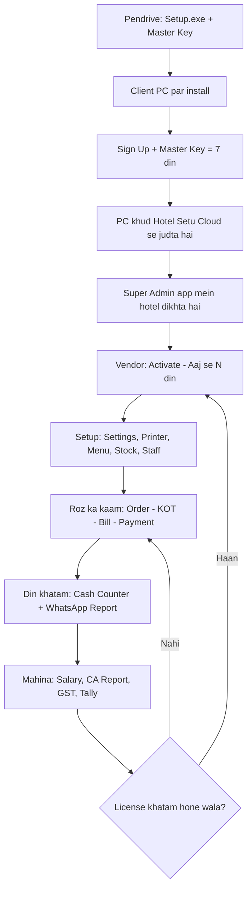
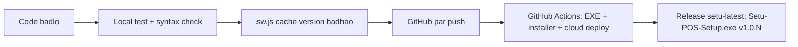

# Setu — End-to-End Workflow

**Setu — Restaurant & Hotel POS** · Powered by Aghanya Devanya Enterprises

Ye document Setu ka poora safar step-by-step batata hai: naye client ko pendrive se software dene se lekar restaurant ke roz ke
kaam, din aur mahine ka hisaab, license, ghar baithe control (Super Admin) aur software update tak.
(Developer ke niyam aur andar ka dhaancha: `AGENTS.md`.)

---

## Poora Flow Ek Nazar Mein

---

## Bhaag 1 — Vendor (Aghanya Devanya Enterprises): Taiyari

### 1.1 Ek baar ka setup
1. **Setu Hotel Admin** app (APK) phone mein install karein → apni **Admin Key** se login → "Is phone par yaad rakho".
2. **Keygen setup:** Admin app → More → **Keygen setup** → `setu-license-private.pem` file chunein → **Save**.
   - Ye file sirf aapke paas rahe (pendrive par backup). Kisi ko na dein, GitHub par kabhi nahi.
3. **Setu AI (optional):** More → Setu AI → Gemini key paste → **Save & Test** → hara ✔.

### 1.2 Pendrive banana (har 6 mahine mein Master Key nayi)
1. GitHub → Releases → **setu-latest** → `Setu-POS-Setup.exe` download (version jaise **v1.0.17**).
2. Admin app → **Keygen** → **Master Key (pendrive ke liye)** → din **7** → **Master Key banao** → **File save** → `Setu-Master-Key.txt`.
3. Pendrive mein dono files: `Setu-POS-Setup.exe` + `Setu-Master-Key.txt`.

> **Master Key:** har naye PC par **ek baar**, sirf **7 din**. Asli din dena bhool gaye to Setu apne aap band. Ek Master Key
> banne ke **180 din** tak naye PCs par lagti hai — phir nayi banaiye. Ye key client ko **mat** dijiye.

### 1.3 Client ke PC ki shartein
- Windows **10 / 11, 64-bit** (8.1 bhi, par purane / 32-bit Windows par installer mana kar deta hai).
- Pehli baar internet (WebView2 aur cloud ke liye). Baad mein billing **bina internet** bhi chalti hai.
- Thermal printer ka Windows driver laga ho.

---

## Bhaag 2 — Naye Client par Install aur Activation

### 2.1 Install (5 minute)
1. Pendrive se **Setu-POS-Setup.exe** par double-click → **Next → Install → Finish**.
2. "Windows protected your PC" aaye → **More info → Run anyway**.
3. Desktop par **Setu** icon ban jaata hai. Setu khulte hi **"Setu — New Restaurant Sign Up"** screen aati hai.

### 2.2 Sign Up
1. Bharein: Hotel / Restaurant naam, Owner naam, Mobile, User ID, Password (6+ akshar, 123456 jaisa nahi), Confirm.
2. **Activation Key** mein `Setu-Master-Key.txt` wali key paste karein → **Sign Up & Activate**.
3. License **7 din** chalu. Apne User ID + Password se **Sign In**.

### 2.3 Cloud se judna (apne aap)
- PC par internet ho to Setu **kuch hi second mein Hotel Setu Cloud se jud jaata hai**. Kuch type nahi karna.
- Admin app → **Hotels** mein naya hotel dikhega (Licence 7 din, version, Install ID).
- Settings (G) → Hotel Setu Cloud box mein "Status: On" aur **Hotel Code** (jaise `SHRIM011`) dikhta hai. Ye code owner ko de dein.

### 2.4 Asli din dena (ghar baithe)
1. Admin app → Hotels → hotel par tap → **Activate**.
2. Plan chunein: 1 Month / 3 / 6 Months / 1 Year / Lifetime / **Apne din**.
3. **Date kaise lage?** → **Aaj se N din** (pehli baar hamesha yahi). Neeche "Licence chalegi: ___ tak" dikhta hai.
4. **Key banao** → "Cloud se seedha PC par bhejo" ✔ → PC online hote hi (Setu khula ho) key apne aap lag jaati hai.

### 2.5 Bina internet wala client (offline)
1. Client se **Install ID** lein (Sign Up / License screen par "Copy" ke saath likha hota hai, jaise `SETU-7F3K-92QD`).
2. Admin app → Keygen → Install ID daalein → plan → **Key banao** → key WhatsApp / pendrive se client ko.
3. Client: Sign Up ya **License (K)** mein key paste → Activate. Internet aate hi cloud se jud jayega.
   (PC par bhi bana sakte hain: `Generate-Activation-Keys.bat` → Install ID → plan.)

### 2.6 Bina computer wala hotel (sirf mobile)
**Tareeka A — Owner khud Sign Up kare (EXE jaisa, Master Key se):**
1. Owner phone mein **SetuPOS.apk** install kare → **Cloud se kholo** → **Naya hotel? Sign Up (Master Key se)**.
2. Hotel naam, type, owner naam, mobile, password aur aapki **Master Key** (pendrive / WhatsApp wali) daale → **Sign Up & Activate**.
3. Hotel turant ban jaata hai (Master Key ke din, jaise 7) aur **Admin app mein dikh jaata hai**. Hotel Code screen par aata hai.
4. Aap Admin app → hotel → **Activate (Din do)** → jitne din dene hain → **Lagao**. Phone par turant.
   Ek phone se ek hi hotel banta hai. Galat / purani key par sign-up nahi hota.

**Tareeka B — Aap khud banao:**
1. Admin app → **More → Naya Hotel banao** → hotel, owner, mobile, type, plan, din, owner password → **Create**.
2. Jo message bane use **WhatsApp / Share** se owner ko bhejein (Hotel Code + password + app ka tareeka).
3. Owner phone mein **SetuPOS.apk** install kare → **Internet se (Hotel Setu Cloud)** → Hotel Code + password → billing shuru.
4. Din dena / renew: Admin app → hotel → **Activate (Din do)** → plan → **Aaj se N din** ya **Purani date mein jodo** → **Lagao**.
   Phone par turant lag jaata hai, key nahi chahiye. Lock / Suspend / Message / Bill count sab waise hi.
5. Internet chahiye (WiFi ya mobile data). Print phone ke print se hota hai (Bluetooth thermal printer ke liye RawBT jaisa
   print-service app). Data cloud par rehta hai, phone kho jaye to bhi safe.

---

## Bhaag 3 — Pehli Baar Setup (Restaurant Owner)

### 3.1 Settings (G)
| Kya bharein | Kyun |
|---|---|
| Restaurant naam, address, phone, GSTIN, GST %, GST Type, FSSAI No. | Bill par chhapta hai (Tax Invoice / Bill of Supply) |
| Menu rate mein GST shamil hai? | ₹80 wahi rahe, bill par GST ka hissa dikhe |
| Owner WhatsApp number | Roz ki report yahin jaati hai |
| CA / Lawyer naam + WhatsApp | Monthly report (J) |
| Bill / KOT paper (A6 ya Thermal 58/80 mm) | Printer ke hisaab se |
| Tables (T-1, T-2 … Parcel) | Billing aur QR |
| UPI ID, Google Review link | Bill par Scan & Pay aur review QR |
| Loyalty, Token system, KOT late alert, Zomato/Swiggy commission % | Apni zarurat se |
| Cashier max discount % | Isse zyada par Manager PIN |
| **Printer Setup** | Thermal printer apne aap pakda jaata hai (naam mein POS / Thermal / 58mm / 80mm). "Seedha Print" = bina popup. Tandoor / Chinese / Bar ke alag KOT printer. **Test Print** se check. |

### 3.2 Menu (M)
- **Menu Import (Excel / Paste):** har line `Category, Dish, Price`, ya chhapa hua menu paste.
- **+ Menu Items Add Karein (Ek Saath):** Naam → Tab → Category → Tab → Price → Enter … → **Save All**.
- Stock apne aap ghatana ho to dish → Edit → **Recipe** mein raw material.

### 3.3 Stock (S) aur Purchase (P)
- **New Stock Item**, ya **Bulk Upload (Excel)**: `Name, Unit, Opening Qty, Min Level, Rate` (**Sample Excel File** button se format).
- Purchase: ek-ek entry, ya **Bulk Purchase (Excel)**: `Item, Qty, Rate, Supplier, Mode, Date, Unit`. Naya item stock mein apne aap
  banta hai. Galat line laal mein line number ke saath dikhti hai; theek kiye bina save nahi hota.

### 3.4 Staff (A) + Login PIN
- **+ Add Staff** → naam, kaam, mobile, monthly salary, **Software Access** (Captain / Cashier / Manager) + apna PIN.
- Cashier / Captain login: Sign In → "Billing Staff / Cashier" → apna PIN (phone par bhi).
- Bill cancel, KOT ke baad item hatana, limit se zyada discount, Settings / Reports par **Manager PIN** lagta hai.

### 3.5 QR Menu (Q), Phone / Tablet, Token — optional
- QR: **Menu Page Download** → `menu.html` online daalein → link Save → **Sab Tables ke QR Print**.
- Phone / tablet: **usi WiFi** par → Settings (G) → "Phone / Tablet Connect" ka QR scan → PIN. Waiter: **Captain App (N)**,
  kitchen: **Kitchen Display (T) → Full Screen**, TV: **Token Display (X)**. Windows Firewall poochhe → Private → Allow.
- Owner ghar se: phone par cloud wala Setu → **Hotel Code + owner password** (internet se, kahin se bhi).

---

## Bhaag 4 — Roz ka Kaam (Order se Payment tak)

### 4.1 Din shuru
1. Setu kholein → Sign In. Kitchen tablet par **Kitchen Display (T)**. **Cash Counter (C)** mein opening cash dekhein.

### 4.2 Order aane ke raaste
| Order kahan se | Kya karein | KOT |
|---|---|---|
| **Dine-In table** | Billing (B) → Dine-In → table → items → **Save Kaccha Bill (KOT)** | Turant |
| **Waiter ka phone** | Captain App (N) → table → items → **KOT Bhejein** | Turant, table ka Kaccha Bill update |
| **Parcel / Takeaway** | Billing → Takeaway → items → **Finalize & Pakka Bill** (token ON ho to token no.) | Pakka bill par |
| **QR menu (WhatsApp)** | QR Menu (Q) → message paste → **Order Lein + KOT Bhejein** | Turant |
| **Zomato / Swiggy** | Zomato & Swiggy Live (Z) → **+ Zomato / Swiggy Order Entry** → items + Order ID → Pakka Bill | Pakka bill par |

### 4.3 Running table (jaise 3 roti, phir 5 roti)
- Pehla KOT **3 × Roti**, doosra sirf **5 × Roti**; bill par ek line **Roti × 8**. Wapas hua to Pakka Bill se pehle Qty −.

### 4.4 Kitchen
- KOT card: Orange = naya, Red = der, Green = ready → **Food Ready** → **Served**. Token wala parcel Token Display par aata hai.

### 4.5 Bill aur Payment
1. Table kholein → discount **₹ ya %** → customer ka mobile (purana ho to naam + loyalty points; **Redeem Points**).
2. Payment: Cash / UPI / Card / Credit / Wallet, ya **Split** (jaise ₹100 Cash + ₹100 UPI; jod bill ke barabar hona chahiye).
3. **Finalize & Pakka Bill** (Ctrl+Enter) → print (Bill + KOT ya sirf Bill) → **Customer WhatsApp Bill**.
4. Galti ho gayi (jaise UPI ki jagah Cash): Bill List (L) → **Edit** → mode / customer badlein. Items galat hon → **Cancel & Re-make**
   (Manager PIN, Audit Log mein record).

### 4.6 Din ke beech ke kharche
- **Purchase (P)** (stock badhta hai, supplier zaroor), **Expense (E)** (gas, sabzi, bijli, advance), **Other Income (I)**.

---

## Bhaag 5 — Din Khatam (Closing)

1. **Audit Log (V):** kisne bill cancel kiya, KOT ke baad item hataya, bada discount, duplicate print, galla short.
2. **Bill List (L):** aaj ke bills → **PDF** / **Excel**. Galat bill → Cancel (stock wapas).
3. **Day Book (D):** saari entries → **Print** / **PDF** / **Excel**.
4. **Cash Counter (C):** note ginkar daalein → Expected vs Counted → **Save & WhatsApp Owner**.
5. **Day Report (W):** **Owner ko WhatsApp** (sales, channel, net, kharche, top dishes, low stock).
6. **Staff (A):** aaj ki haaziri (P / H / A / W) ya **Baaki Sab Present**.
7. **Backup:** PC khud roz copy banata hai (60 din) aur cloud par bhi jaata hai. Hafte mein ek baar Settings (G) →
   **Download JSON Backup** → pendrive / Drive.

> Saari files (PDF, Excel, Tally, JSON backup) PC ke **Downloads\Setu** folder mein save hoti hain; folder apne aap khul jaata hai.

---

## Bhaag 6 — Hafte / Mahine ka Kaam

### 6.1 Reports & Tally (F)
- Aaj / Kal / 7 Din / Is Mahine / Pichhla Mahina / Is Saal → Summary, Day-wise, Bill-wise, Item-wise, Category, Hourly, Payment Mode,
  Channel, **GST Summary**, Discounts, Cancelled, Expenses, Top Customers.
- Buttons: **Print**, **PDF**, **Excel**, **Tally XML Export** (Tally mein pehle ledgers: Sales, CGST, SGST, Round Off, Cash, UPI, Card,
  Credit Sales, Customer Wallet, Zomato, Swiggy → Gateway of Tally → Import Data → Vouchers).

### 6.2 Monthly Report → CA / Lawyer (J)
1. Mahina chunein → **WhatsApp to CA / Lawyer** (poora hisaab message mein) → Send.
2. Files: **GST Bill Register (Excel)**, **Day-wise Sales (Excel)**, **PDF Report** → WhatsApp mein khud attach karein.
3. Mahine ki 1–10 tarikh ko dashboard yaad dilata hai; bhejne ki date record rehti hai.

### 6.3 Staff Salary (A)
1. Roz haaziri → "Din Aaye" apne aap (P + W + H/2). Purani galti → "Poore Mahine ki Haaziri" chart mein click.
2. Mahine ke end: Salary Sheet → **Save Changes** → **Sabko Salary Pay** (Cash / UPI) ya har line par **Pay** / **Advance**.
3. **PDF** / **Excel** se sheet nikalein; staff ko **Slip** WhatsApp par.
4. **Salary Records:** har mahine ki sheet apne aap record (Save / Pay / PDF / Excel par). Baad mein salary badle ya staff chhode,
   purana mahina waisa hi rehta hai; har mahine ka PDF / Excel wahin se.

### 6.4 Customers & Offers (R), Suppliers (U), Settlement (Y), Multi-Outlet (O)
- **R:** group chunein (Repeat / 30+ din se nahi aaye / Top 20 / Points) → message → ek-ek karke WhatsApp; **Wallet Top-up**; Excel list.
- **U:** har supplier ka kharid, udhaar, diya, **baaki** → **Pay** → **Ledger**.
- **Y:** Zomato / Swiggy ka gross, commission, aana chahiye → **+ Payment Aaya** (amount + UTR) → farak milaayein.
- **O:** har branch **Summary File Download** → owner **Outlet Files Import** → sab branches ek jagah.

---

## Bhaag 7 — Madad: Help & Support, Error Log, Setu AI

- **Help & Support (1):** client vendor ko ticket likhta hai → Admin app → **Tickets** (laal badge) → jawab → client ke Setu mein dikhta hai.
- **Error Log (2):** har galti ka **kya hua, kahan, kaise, kaise theek karein** (jaise "printer nahi chuna → Settings → Printer Setup").
  Bug ho to Error Log ka text ticket mein bhejein.
- **Setu AI (3):** owner / manager poochh sakte hain "aaj kya sabse zyada bika", "kaunsa din dheema hai". AI ko sirf totals dikhte hain,
  customer ka naam / number nahi. Premium / Diamond plan mein ON (ya Super Admin se hotel par ON). AI code theek nahi karta.

---

## Bhaag 8 — Super Admin (Vendor ka roz ka control, ghar baithe)

### 8.1 Hotels list
- Upar chips: **Sab / Dhyan do** (licence ya payment ≤ 5 din, ticket, sync ruka) / Locked-Suspended / Tickets / Backup nahi.
- Har card: licence ke din, last sync, **Setu version** ("purana" = naya EXE install karwana hai).

### 8.2 Hotel par tap → bade buttons
| Button | Kab | Kya hota hai |
|---|---|---|
| **Activate** | Naya client / renew | Keygen khulta hai, key PC par seedhi jaati hai |
| **Warning** | Payment due | Setu chalta rahe, upar laal patti mein message |
| **Lock / Unlock** | Payment nahi aaya | Setu par "Setu band hai" screen; data safe; Unlock se turant chalu |
| **Suspend / Activate** | Account band karna | Lock screen + cloud saving ruki; Activate se wapas |
| **Message** | Koi suchna | Setu mein popup |
| **Tickets** | Client ki shikayat | Baat-cheet aur jawab |
| **Backup** | Data ki copy chahiye | Hotel ka poora data JSON file (save / share) |
| **Password** | Owner password bhool gaya | Naya password: phone app par turant, PC par agle sync ke baad |
| **Sab settings** | Plan / features / bill design / rules / domain / support link / sync key | Purani detail wali screen |
| **Delete** | Hotel hatana | Hotel Code type karke; chahein to us computer ko **Block** |

### 8.3 Renew ya date badalna
- Hotel → **Activate** → plan → **Purani date mein jodo** (bache din + naye) ya **Aaj se N din** (exact date, kam bhi kar sakte hain)
  → Key banao. ("Aaj se" wali key ke liye Setu **v1.0.16+** chahiye; Keygen khud batata hai.)

### 8.4 Payment due ka kram
1. 5 din pehle: **Message** / Call / WhatsApp (card par buttons).
2. Due date par: **Warning**.
3. Phir bhi nahi: **Lock**. Lambe samay tak: **Suspend**.
4. Payment aaya: **Unlock / Activate** + **Activate (key)** se din.

---

## Bhaag 9 — Mushkil Haalat

| Haalat | Kya karein |
|---|---|
| Owner password bhool gaya | Admin app → hotel → **Password**, ya Keygen → **Password Reset** key → Sign-in par "Password bhool gaye?" |
| PC kharab / Windows format / naya PC | Naye PC par Setup.exe → (a) Sign-up screen par **Restore from Backup File (.json)**, ya (b) Master Key se Sign Up → Settings (G) → Hotel Setu Cloud → **"Naya computer? Purana hotel ka data cloud se laayein"** → purana Hotel Code + owner password. Naye PC ka licence apna rehta hai (Install ID nayi); sign-up se bana khaali naya hotel Super Admin se Delete kar dein. |
| Licence khatam, screen lock | Admin se **Activate** bhejein (PC online), ya License (K) / lock screen par nayi key. Data safe rehta hai. |
| PC ki date peeche ki | Setu lock ho jaata hai; sahi date lagayein ya nayi key. |
| Hotel Super Admin mein nahi dikh raha | PC par internet? Settings → Hotel Setu Cloud "Status: On"? Admin app mein **↻** aur "Sab" chip. |
| Print nahi ho raha | Error Log (2) dekhein → Settings → Printer Setup → printer chunein → **Test Print**. |
| Download / PDF nahi mil raha | `Downloads\Setu` folder dekhein (Setu khud kholta hai). |

---

## Bhaag 10 — Software Update

### 10.1 Developer (code se naya EXE)

1. Niyam `AGENTS.md` mein. `python app_main.py --server --port 8000 --data ./test-data` se local test.
2. Push karte hi GitHub apne aap banata hai: **EXE + installer** (release `setu-latest`, version `1.0.<build>`), **cloud deploy**,
   aur `android-admin` badla ho to **APK**. Admin page ke badlav ke liye naya APK nahi chahiye.

### 10.2 Client ke PC par update
1. Naya `Setu-POS-Setup.exe` purane ke upar install karein (uninstall ki zarurat nahi).
2. Data (`%LOCALAPPDATA%\AghanyaDevanyaERP\Data`), license aur login **waise hi rehte hain**. Phir bhi pehle ek JSON backup le lein.
3. Super Admin mein us hotel ka version naya dikhne lagega.

---

## Shortcut Keys

| Key | Screen | Key | Screen |
|---|---|---|---|
| B | Billing | S | Stock Summary |
| Z | Zomato & Swiggy | M | Menu Items |
| L | Bill List | T | Kitchen Display |
| P | Purchase | Q | QR Menu & Orders |
| E | Expense | R | Customers & Loyalty |
| I | Other Income | A | Staff & Salary |
| D | Day Book | O | Multi-Outlet |
| C | Cash Counter | N | Captain App |
| W | WhatsApp Day Report | H | Table Reservations |
| F | Reports & Tally | X | Token Display |
| U | Suppliers & Udhaar | Y | Zomato/Swiggy Settlement |
| J | Monthly Report → CA | V | Audit Log (Chori Check) |
| K | License | G | Settings & Backup |
| 1 | Help & Support | 2 | Error Log |
| 3 | Setu AI | | |

**Esc** = wapas · **Ctrl+Enter** = Pakka Bill · **Alt + letter** = kisi bhi screen se seedha jump

---

## Dhyan Rakhein

- Billing hamesha **counter PC** par chalti hai, internet ho ya na ho. Internet aate hi cloud sync ho jaata hai.
- Phone / tablet restaurant ke WiFi par counter se chalte hain; ghar se owner cloud wale Setu (Hotel Code + password) se dekhta hai.
- **Zomato / Swiggy** orders haath se entry hote hain (seedha API ke liye unki partner approval chahiye).
- **WhatsApp** messages ek-ek karke jaate hain (bulk auto-send ke liye WhatsApp Business API chahiye).
- Har PC ki apni Install ID aur apni key. Master Key sirf vendor ki pendrive mein.
- `setu-license-private.pem` aur Admin Key kabhi kisi ko nahi. Kho gayi to turant vendor / developer ko batayein.

### Hotels ke errors Admin app mein
- Har hotel ke har device (counter PC, phone) ki galti apne aap Admin app mein aati hai (internet par, har minute).
- Hotels list: laal **"N error"** tag, aur upar **"Errors (24 ghante)"** chip se sirf wahi hotels.
- Hotel kholo → **Error Log** tile: kya galti hui, kis device par, kahan, kitni baar, kab. **Copy** se WhatsApp par bhej sakte hain.
- Printer ki galti → client ko Printer Health (4) dekhne ko kahein.

